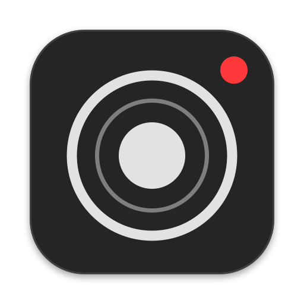

<p align="center"><a href="README.pt-BR.md">🇧🇷 Leia em português</a></p>

<p align="center"></p>

<h1 align="center">bmonitor</h1>

<p align="center">Monitor and remote-control an iPhone running <b>Blackmagic Camera</b> from your Mac.<br>
Live video and audio over Wi‑Fi, about 0.3 s behind real time.</p>

<h3 align="center"><a href="https://github.com/dantearaujo/bmonitor/releases/latest/download/bmonitor.dmg">⬇️ Download bmonitor for Mac</a></h3>

<p align="center"><sub>Latest version · Apple Silicon · macOS 15 or later · <a href="#install">how to install</a></sub></p>

<p align="center"><b>⚠️ Public beta (0.9.3).</b> It works every day on the author's setup, but it was tested on one Mac and one iPhone. Expect rough edges and <a href="https://github.com/dantearaujo/bmonitor/issues">report them</a>.</p>

The app speaks English and Brazilian Portuguese, following your Mac's language.

---

## What it does

You record yourself with an iPhone on a tripod. bmonitor turns the Mac next to it into the camera's monitor and remote control, without a second iPhone or iPad.

- **Monitor:** live video in a regular Mac window, landscape or portrait, with a recording tally (red border), timecode, remaining recording time, and signal status. Framing grids: thirds, golden ratio, center cross, and more.
- **Audio:** the active microphone's name and an L/R peak meter styled after Blackmagic's own (green, yellow, red), plus the camera's sound on the Mac, muted by default.
- **Remote control:** start and stop recording, ISO, shutter (speed or angle), white balance with light presets, tint, focus (click the video to focus there), zoom, lens, stabilization, and audio input.
- **Keyboard:** one key per control (`I` ISO, `S` shutter, `W` white balance, `T` tint, `L` lens, `A` audio, `M` mute, `G` grid, `F` focus now), `⌘R` to record, `⌘→` to rotate. `⌘/` shows them all.
- **Updates itself:** bmonitor checks for a new version once a day and asks before installing. You can also use **bmonitor › Check for Updates…**.
- **Readable from 3 m:** status lives in the top corners and stays large. The control bar appears when you move the mouse and hides after 3 s.

## Requirements

| | |
|---|---|
| Mac | Apple Silicon, macOS 15 Sequoia or later (tested on macOS 26 Tahoe; macOS 15 untested in this beta) |
| iPhone | [Blackmagic Camera](https://apps.apple.com/app/blackmagic-camera/id6449580241) (free), tested with version 3.5 |
| Network | Mac and iPhone on the **same Wi‑Fi network** |

## Install

1. [Download bmonitor.dmg](https://github.com/dantearaujo/bmonitor/releases/latest/download/bmonitor.dmg), always the latest version. Older versions live in [Releases](https://github.com/dantearaujo/bmonitor/releases).
2. Open the `.dmg` and drag **bmonitor** to **Applications**.
3. Open bmonitor. macOS asks to confirm opening an app downloaded from the internet: click **Open**. bmonitor is signed and notarized by Apple.
4. When macOS asks to let bmonitor **find devices on your local network**, click **Allow**. Without this, the app can't see the iPhone.

## Set up the iPhone

Do this once in the Blackmagic Camera app:

1. Open Blackmagic Camera and go to its settings.
2. Set **Remote Camera Control** to **Remote Camera**. If it asks what the camera is available for, allow both control and monitoring.
3. In **Network Access**, turn on the **HTTP server**.
4. Allow Blackmagic Camera on the local network: iOS **Settings › Privacy & Security › Local Network › Blackmagic Camera** on.

Every time you record:

- connect the iPhone and the Mac to the same Wi‑Fi;
- leave Blackmagic Camera open **on the camera screen**;
- turn off auto-lock (iOS **Settings › Display & Brightness › Auto-Lock › Never**), or the stream stops when the screen locks.

Then open bmonitor. It finds the iPhone by itself and shows the video in a few seconds. With more than one iPhone on the network, it asks which one to use.

## What bmonitor changes on your iPhone

bmonitor receives the video through Blackmagic Camera's **live stream** feature, the same one used to stream to YouTube or other platforms:

- On the first connection it adds a custom streaming platform called **Mac Monitor SRT** to Blackmagic Camera. It only sends it again if your Mac's address changes.
- While bmonitor is open, that platform is the active one and the iPhone streams to your Mac.
- When you quit bmonitor (`⌘Q`, closing the window, or Ctrl‑C in a terminal), it stops the stream and **restores the platform you had before**.
- If bmonitor is force-quit or crashes, the iPhone keeps pointing at the Mac. Open bmonitor and quit it normally once, and your original platform comes back.

Recording stays on the iPhone, in the quality you chose there. The stream to the Mac doesn't change your recording settings.

## Troubleshooting

| Symptom | What to check |
|---|---|
| "Searching for iPhone" never ends | Same Wi‑Fi on both; Blackmagic Camera open on the camera screen; Remote Camera Control set to Remote Camera; HTTP server on; Local Network allowed for **both** apps (Mac: System Settings › Privacy & Security › Local Network). VPNs and guest networks often block devices from seeing each other. |
| Connects, but "Waiting for video" stays | A firewall on the Mac may be blocking the incoming stream (UDP port 9000). Allow bmonitor in System Settings › Network › Firewall. |
| "No camera" | Blackmagic Camera closed or the iPhone locked. Open it again; bmonitor reconnects by itself. |
| Video stutters | Weak Wi‑Fi. Move closer to the router or use 5 GHz. The "Packet loss" status in the top right shows lost packets. |

## Privacy

bmonitor collects nothing. It talks only to the iPhone on your local network: no accounts, no analytics, no internet access.

## Build from source

```sh
brew install srt
swift build -c release
swift test
scripts/build-app.sh --install --dmg   # bmonitor.app in /Applications and a .dmg in .build/dist
```

The packaging script bundles libsrt and OpenSSL inside the app, generates the icon (`scripts/make-icon.swift`), and signs ad hoc. `DESIGN.md` documents the interface. Code comments are in Portuguese.

## How it works

The Mac talks to Blackmagic Camera's REST and WebSocket API (port 4444) for status and controls. For video and audio, it points the camera's live stream (SRT, MPEG‑TS with HEVC and AAC) at itself, then demuxes and decodes every frame with VideoToolbox with no buffering queue. Glass to glass, that measures about 0.3 s, most of it on the iPhone side.

## License

MIT, see [LICENSE](LICENSE). Bundled libraries and trademarks: [THIRD_PARTY_NOTICES.md](THIRD_PARTY_NOTICES.md).

bmonitor is an independent project, not affiliated with or endorsed by Blackmagic Design.

